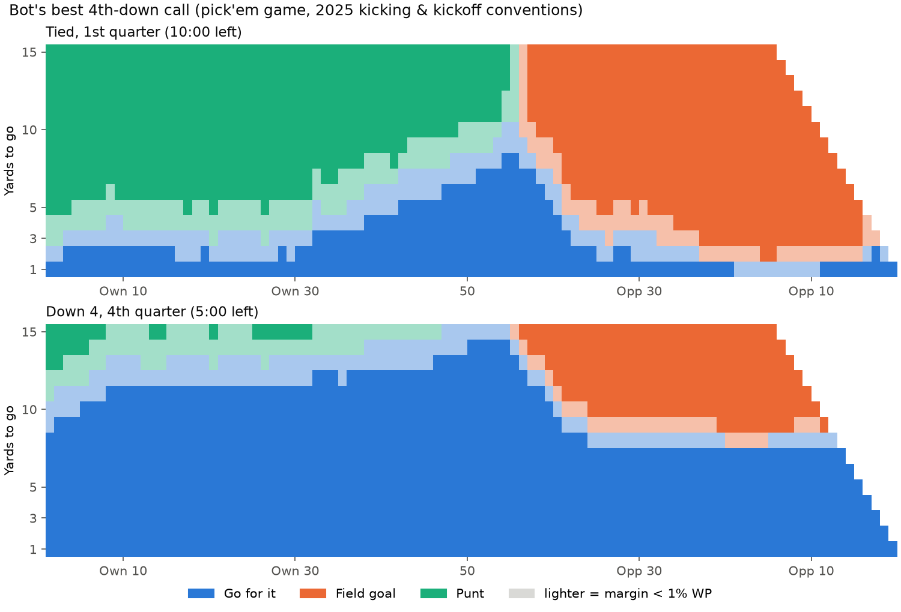
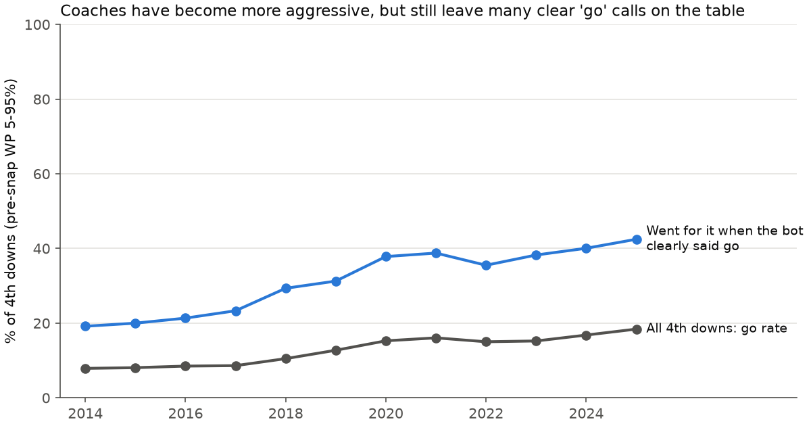
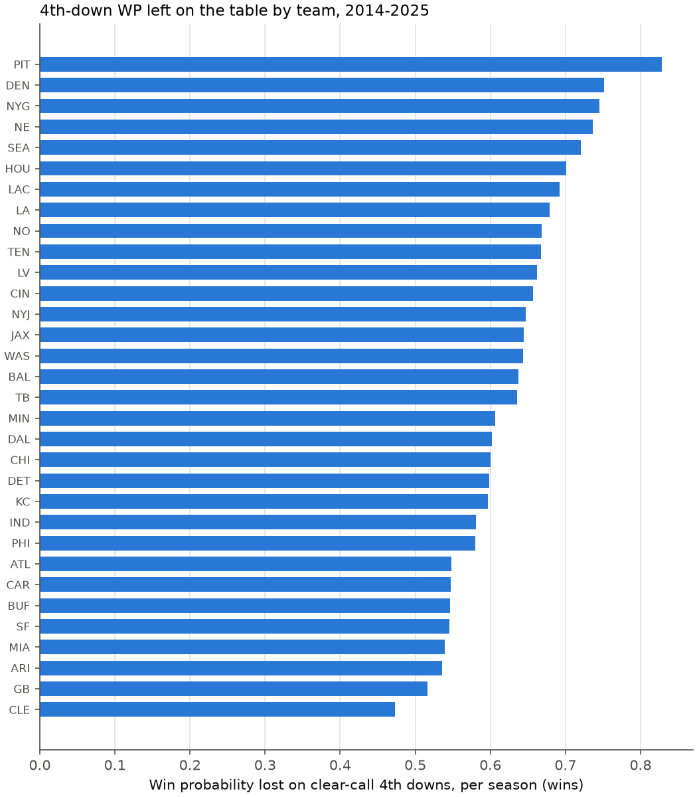
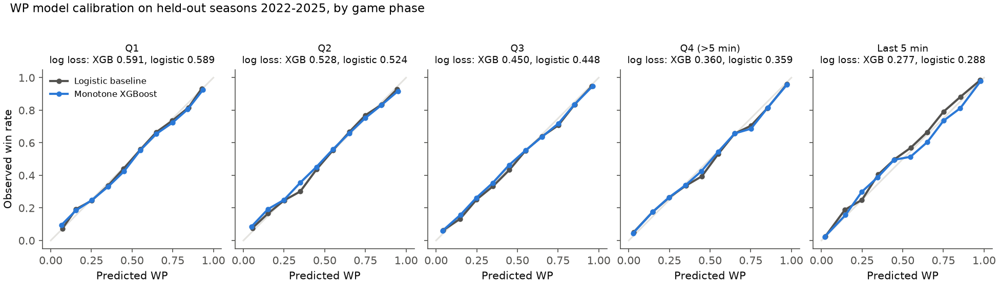

# NFL 4th-Down Decision Bot

[](https://github.com/lukahere007/nfl-fourth-down-bot/actions/workflows/ci.yml)

[](LICENSE)

**On 4th down, should an NFL team go for it, kick a field goal, or punt? And how much win probability do coaches give up by choosing wrong?**

I built a win-probability (WP) model from scratch, added sub-models for each 4th-down outcome, and wrote a decision engine that scores all three options for every 4th down from 2014 to 2025 (46,891 plays). A bootstrap layer then says whether each call is clear or close to a coin flip.

## Answer

| | |
|---|---|
| **The main error is not going for it** | In decision-relevant situations (pre-snap WP 5–95%, more than 30 s left in the half), the bot was confident (bootstrap agreement ≥ 90%, margin ≥ 1 WP point) on **25,216 of 34,880** 4th downs. When it confidently said *go*, coaches went for it only **31.6%** of the time. When it said *punt*, they punted **99.3%** of the time, and when it said *field goal*, they kicked **89.3%** of the time. |
| **Cost** | Confident calls that coaches got wrong cost **241.6 wins** over 12 seasons, about **0.63 wins per team per season** (0.57 in 2025). **94%** of that loss comes from not going for it. |
| **Trend** | When the bot clearly said go, coaches went **21.0%** of the time in 2014–17 and **39.2%** in 2022–25 (42.5% in 2025). Over all 4th downs, the go rate rose from 7.9% (2014) to 18.4% (2025). |
| **Who** | Pittsburgh lost the most (0.83 wins/season) and Cleveland the least (0.47). Among coaches with at least 3 seasons, Jonathan Gannon (0.35), Frank Reich (0.40), Matt LaFleur (0.41) and Nick Sirianni (0.42) lost the least per season. Jeff Fisher (0.86) and Mike Tomlin (0.83) lost the most. |
| **Close calls are rare** | Only **1.4%** of relevant 4th downs are genuine coin flips (bootstrap agreement < 60%). Most calls are clear once you put numbers on them. |



*Best call by distance and field position in a pick'em game (2025 kicking and kickoff rules). Lighter cells mean the margin is under 1 WP point. Tied in the 1st quarter, the bot goes on 4th-and-1 almost anywhere, and the "go" zone is widest near midfield: up to about 4th-and-7, narrowing to 4th-and-2 or 3 around the opponent's 30. Down 4 with 5:00 left, a field goal barely helps, and "go" fills most of the chart.*





### Four situations from the data

These are picked by rule in `scripts/analyze.py`: the largest loss for each kind of mistake among confident calls outside the last two minutes of a half, plus the postseason call with the most at stake where the bootstrap was split. Numbers are the bot's expected WP for the offense.

| Game (date) | Situation | Coach | Go / FG / Punt | Bot |
|---|---|---|---|---|
| BUF at OAK (2014-12-21) | BUF down 2, 4th-and-1 at own 46, 8:22 left in Q4 | Punt | **60.0%** / 32.8% / 43.4% | Go, +16.6 pts, 100% of bootstraps |
| ATL at SF (2015-11-08) | ATL down 4, 4th-and-goal at the 1, 3:00 left | 19-yd FG (good) | **60.4%** / 42.0% / 20.7% | Go, +18.4 pts, 100% |
| ARI at SEA (2022-10-16) | SEA up 9, 4th-and-19 at own 10, 0:59 left in Q3 | Fake punt (punter run, fumbled, returned for a TD) | 70.0% / 63.1% / **80.6%** | Punt, +10.6 pts, 100% |
| Super Bowl LII, PHI vs NE (2018-02-04) | NE down 6, 4th-and-1 at PHI 8, 14:18 left in Q2 | 26-yd FG (missed, mishandled snap) | 54.0% / 54.0% / 43.4% | Coin flip: 54% of bootstraps favour *go* |

## What's creative here

**1. A win-probability model that can't contradict football logic.** The model is gradient boosting (XGBoost) on the pre-snap state: score, both clocks, down, distance, yardline, timeouts, home, who gets the 2nd-half kickoff, and the pre-game spread as a team-strength prior that fades as the game goes on. It has **monotone constraints**: WP can never go *down* when you add a point to your lead, move closer to the end zone, gain a timeout, or are a bigger favourite. This matters more for a decision bot than for a forecaster. The engine compares WP between neighbouring states (ball at the 35 vs the 40), so any small non-monotone wiggle becomes a wrong call. On the 2022 hold-out, an unconstrained version broke these rules on **12%** of probes for score, **9%** for field position, **33%** for spread and **43%** for timeouts. It also scored worse (log loss 0.523 vs 0.519). The constrained model has **0** violations.

*Analogy:* the constraints are guard rails on a mountain road. The model still chooses its own line through each curve, but it can't drive off the cliff where the data are thin.

**2. Shape-constrained "GAM" sub-models in about 80 lines of numpy/scipy.** Conversion probability and field-goal accuracy use a penalised logistic GAM built on piecewise-linear *ramp* splines. Each ramp basis function rises 0→1 across one knot interval, so its coefficient is the change in log-odds across that interval. A curve that is guaranteed to decrease with distance is then just bounds (`coef ≤ 0`) in L-BFGS-B. A second-difference penalty (P-spline style) smooths it where data are thin, for example 60+ yard kicks. I chose this over isotonic regression (step-shaped, no covariates) and over unconstrained splines (which bend upward at long range, because only strong-legged kickers try 60-yarders: selection bias). Field position enters the conversion model as an unconstrained smooth, since the goal line compresses the defence. Spread, season and a 3rd-vs-4th-down indicator enter linearly.

**3. Punts as a smooth conditional *distribution*, not an average.** Punt outcomes (the receiving team's next snap: touchbacks, returns and blocks included) are summarised as 10 Gaussian-kernel-weighted quantiles at each line of scrimmage. Each quantile is then made monotone with isotonic regression. Using the full spread of outcomes matters because WP is non-linear in field position, so the average punt is not worth the same as the average of punt outcomes.

**4. WP curves, then arithmetic.** For each 4th down the engine runs the WP model once per reachable state: our 1st down at every yardline, their 1st down at every yardline, and after we score 3/6/7 and kick off. It also handles possession flips, halftime (the 2nd-half receiver gets the ball) and the end of regulation. Each action's expected WP is then a dot product of outcome probabilities with these curves. That makes the arithmetic unit-testable with hand-built curves, and it makes the uncertainty layer cheap.

**5. A confidence score for every call.** I refit every sub-model on 100 **game-level cluster bootstraps** (whole games resampled, because plays within a game are correlated) and rerun the arithmetic over the fixed WP curves. A call's confidence is the share of refits that agree with it. That separates "go for it, obviously" from "this is a coin flip, defer to the coach."

**6. No leakage in the grading.** Every 4th down is graded by a WP model that never saw its game (leave-one-3-season-block-out), so a game's final score can't leak into the grade of its own 4th downs.

## How good is the WP model?

Walk-forward: each test season 2022–2025 is predicted by models trained only on earlier seasons (164,735 held-out snaps).

| Model | Log loss | Brier |
|---|---|---|
| **Monotone XGBoost (this repo)** | 0.4687 | 0.1547 |
| Logistic baseline (same features, hand-built interactions) | 0.4677 | 0.1542 |
| nflverse `vegas_wp` *(reference only: trained on data that includes these seasons)* | 0.4662 | 0.1536 |
| nflverse `wp` (no spread) | 0.5003 | 0.1685 |



To be honest about it: **overall, the boosted model ties the logistic baseline. It doesn't beat it.** Early in the game, game outcomes are mostly noise, and a well-designed logistic model with a time-decayed spread and the nflfastR-style `score / exp(-4·elapsed)` feature is hard to beat there. XGBoost is slightly worse in Q1–Q4 (0.591 vs 0.589 in Q1). **It wins clearly in the last 5 minutes (0.277 vs 0.288)**, where interactions between timeouts, clock and score matter and where 4th-down decisions carry the most WP. Both models are well calibrated in every phase. nflverse's `vegas_wp` is a little better, but it was fit on these seasons, so it isn't a fair out-of-sample comparison.

## Sub-model sanity checks (2025, league-average team)

- Conversion: 4th-and-1 at midfield 71%, 4th-and-2 61%, 4th-and-4 51%, 4th-and-10 30%. 4th-and-goal at the 1: 58%.
- Field goals: 33 yards 95%, 50 yards 74%, 55 yards 66%, 60 yards 49% (the 2014 values were 93/67/58/41%; kickers improved).
- Kickoff convention: the median start after a kickoff, measured from the data, moved from the 20 (2014–15) to the 25 (2016–23), then the 30 (2024) and the 31 (2025, new kickoff rules).

## Reproduce

```bash
git clone https://github.com/lukahere007/nfl-fourth-down-bot.git
cd nfl-fourth-down-bot
python -m pip install -r requirements.txt

# Fast path: everything from committed files (seconds)
pytest -q
python scripts/analyze.py                      # tables in results/, figures in figures/
python scripts/decide.py --ydstogo 2 --yardline 38 --score-diff -3 --minutes-left 6 --boot 50

# Full rebuild from raw nflverse data (~240 MB download, ~25 min on a laptop CPU)
python scripts/fetch_data.py                   # 2014-2025 into data/raw/ (gitignored)
python scripts/build_dataset.py                # slim tables into data/derived/
python scripts/train_wp.py                     # walk-forward evaluation + models/wp_xgb.json
python scripts/run_decisions.py --boot 100     # grades every 4th down -> results/decisions.parquet
python scripts/analyze.py
```

Example output of `decide.py`:

```
4th-and-2 at 38 yards from goal, score diff -3, 6 min left
  WP now (before the snap): 39.5%
  go     41.5%
  fg     38.4%
  punt   28.8%
  -> GO (by 3.1 WP points)
```

## Repository layout

```
├── data/derived/            # slim parquet tables (committed, ~9 MB); data/raw/ is gitignored
├── models/wp_xgb.json       # monotone WP model fit on 2014-2025
├── results/                 # decisions.parquet (every graded 4th down) + summary tables
├── figures/
├── scripts/
│   ├── fetch_data.py        # download nflverse play-by-play
│   ├── build_dataset.py     # raw -> derived tables
│   ├── train_wp.py          # walk-forward WP evaluation, calibration, monotonicity audit
│   ├── run_decisions.py     # grade every 4th down + bootstrap confidence + decision chart
│   ├── analyze.py           # tables, headline numbers, figures
│   └── decide.py            # ask the bot about one situation
├── src/fourth_down/
│   ├── data.py              # pre-snap state + outcome tables
│   ├── state.py             # possession flip, clock, halftime, WP features, constraints
│   ├── wp_model.py          # monotone XGBoost + logistic baseline + metrics
│   ├── gam.py               # shape-constrained logistic GAM, kernel quantiles
│   ├── submodels.py         # conversion / FG / punt / gain models + cluster bootstrap
│   └── engine.py            # WP curves, expected-WP arithmetic, recommendation, confidence
├── tests/                   # 23 pytest tests (state algebra, toy arithmetic, extremes, monotonicity)
└── .github/workflows/ci.yml
```

The tests cover:
- the possession-flip and halftime state transforms;
- expected-WP arithmetic on hand-built curves with known answers;
- monotonicity of the WP model, both on synthetic data and on the committed model;
- obvious calls, both with an analytic toy WP and with the real model: 4th-and-1 at the opponent's 1, down 4 with 2:00 left → **go**; 4th-and-20 at your own 10 early → **punt**; tied with 5 s left at the opponent's 10 → **FG**.

## Limitations

- **The WP model has error.** It is only as good as a log loss of about 0.47. Small gaps (< 1–2 WP points) are inside the model's error, which is why "clear call" requires a margin of at least 1 point *and* bootstrap agreement.
- **The confidence score covers sub-model uncertainty only.** The WP model is held fixed, so the coin-flip share (1.4%) understates true uncertainty. A natural extension is to bootstrap the WP model too.
- **League-average teams.** Conversion odds use the pre-game spread as the only team-strength signal. A team with an elite short-yardage offense or a weak kicker deviates from the bot's assumptions, and coaches know things the bot doesn't (injuries, weather beyond wind, matchups).
- **Selection bias.** Conversion rates are learned from attempts teams *chose* to make, so they probably overstate how well an average team would convert in every situation where it punted. Pooling with 3rd downs (plus a 4th-down indicator) dampens this but doesn't remove it. Part of "coaches are too conservative" could be this bias.
- **Simplified mechanics.** Every 4th-down snap uses 6 s of clock. Penalties, return touchdowns on punts (excluded, as are muffed punts the kicking team recovers), the yardage of failed attempts (the ball is placed at the line of scrimmage), two-point tries and onside kicks aren't modelled. Snaps with 30 s or less left in a half are left out of the headline numbers for this reason.
- **Late, sparse states.** In rare late-game states, such as a heavy favourite tied with under a minute left, the WP model can be overconfident. The examples above are therefore taken from outside the final two minutes.
- **Overtime** is not modelled. A tie at the end of regulation counts as a 50% win.

## Data and licences

- Play-by-play: [nflverse-data releases](https://github.com/nflverse/nflverse-data/releases/tag/pbp) (`play_by_play_YYYY.parquet`), © nflverse contributors, **CC-BY 4.0**. The nflverse `wp` / `vegas_wp` columns are used only as a reference benchmark.
- The derived tables in `data/derived/` are subsets and transformations of that data under the same licence.
- Code: MIT © 2026 Luke Wamalwa.
